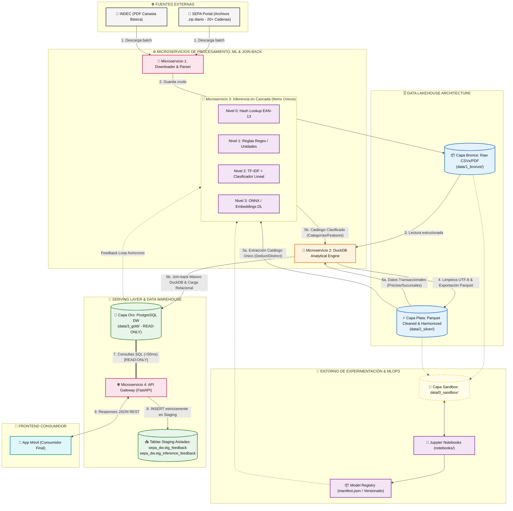

# Arquitectura General del Sistema - SEPA Lakehouse & ML Engine

Bienvenido a la documentación técnica oficial del **Proyecto Canasta SEPA** (`sepa-lakehouse-ml`). Este documento describe la arquitectura global, los flujos de datos end-to-end, las facetas operativas y las decisiones de diseño de infraestructura de grado industrial basadas en **Parquet y DuckDB**.

## Justificación de la Arquitectura: Data Lakehouse

Utilizaremos una arquitectura Data Lakehouse que nos permitirá almacenar, procesar y analizar datos estructurados, semiestructurados y no estructurados en un solo sistema. Nos permitirá utilizar una capa de datos compartida y evitar mantener dos esquemas de datos diferentes (como un Data Lake y un Data Warehouse separados). En nuestro caso, esto es clave para unificar los archivos crudos (CSVs del SEPA y PDFs del INDEC) en la Capa Bronce/Plata, procesarlos eficientemente con **DuckDB** en memoria y consolidarlos en archivos columnares **Parquet** y un entorno relacional listo para analítica y Machine Learning.

### 🎯 Beneficios Directos para el Proyecto

* **Soporte Multi-Formato:** Permite ingerir tanto la volumetría heterogénea de los CSVs diarios del SEPA como la extracción no estructurada de los PDFs de la Canasta Básica del INDEC sin forzar esquemas rígidos desde el día uno.
* **Eliminación de Redundancia:** Evita duplicar infraestructura o mantener procesos ETL complejos e independientes entre un almacenamiento de archivos crudos y una base de datos analítica.
* **Evolución Medallón Natural:** Establece una línea de ensamblaje clara donde el dato fluye en un solo sentido: **Crudo/Inmutable (Bronce) $\rightarrow$ Limpio/Armonizado (Plata en Parquet) $\rightarrow$ Relacional/Analítico (Oro)**.
* **Simplicidad y Eficiencia con DuckDB:** Elimina la sobrecarga de clústeres distribuidos pesados (JVM, dependencias de Hadoop) permitiendo procesamiento analítico vectorizado ultrarrápido con bajo consumo de memoria y ejecución directa sobre archivos Parquet.

---

## 1. Diagrama de Arquitectura End-to-End (Mermaid.js)

El siguiente diagrama detalla el flujo de datos desde la captura de publicaciones diarias en el portal SEPA y la ingesta del PDF del INDEC hasta el consumo por parte de la aplicación móvil del usuario final, incorporando la arquitectura Medallion (Bronze/Silver/Gold), el **Patrón Join-Back (Maestro-Detalle)** para deduplicación e inferencia eficiente, el **Model Registry MLOps**, la **Capa Sandbox** de experimentación, el **Pipeline de Inferencia ML en Cascada (N0 a N3)** con **Feedback Loop Desacoplado**, la protección **Read-Only del Data Warehouse Oro** y el procesamiento analítico mediante **DuckDB y Parquet**.

---

## 2. Resumen de Capas y Facetas del Sistema

| Capa / Faceta | Componente Principal | Tecnología Clave | Descripción / Responsabilidad | Documentación |
| :--- | :--- | :--- | :--- | :--- |
| **Visión** | Visión del Proyecto | Estrategia / Negocio | Contexto, problemas, solución, propósitos y criterios de éxito del proyecto. | [00-vision-del-proyecto.md](00-vision-del-proyecto.md) |
| **Sandbox** | Capa Sandbox | Jupyter Notebooks / Python | Espacio temporal desechable (`data/0_sandbox/`) alimentado por Bronce y Plata para ensayos de parsing crudo, prototipado ML/NLP y feature selection. | [01-arquitectura-general.md#4-capa-sandbox-data0_sandbox](01-arquitectura-general.md#4-capa-sandbox-data0_sandbox) |
| **MLOps** | Model Registry | JSON Manifest / PKL / ONNX | Gobierno de artefactos con puerta de promoción estricta ($F1\text{-Score} \ge 0.90$) e instanciado versionado. | [04-ml-clasificacion.md](04-ml-clasificacion.md) |
| **Faceta 1** | Ingesta Bronce | Python / urllib / INDEC Parser | Descarga automatizada e ingesta de archivos ZIP/CSV del SEPA y PDF del INDEC a `data/1_bronze/`. | [02-ingesta-bronce.md](02-ingesta-bronce.md) |
| **Faceta 2** | Lakehouse Plata | DuckDB / Parquet | Limpieza masiva UTF-8, validación EANs, normalización regex de unidades y estructuración en `data/2_silver/productos_armonizados/`. | [03-lakehouse-plata.md](03-lakehouse-plata.md) |
| **Faceta 2** | Clasificación Cascada | Join-Back / DuckDB / Linear / ONNX | Inferencia sobre catálogo deduplicado único y Join-Back masivo con DuckDB antes de cargar la Capa Oro. | [04-ml-clasificacion.md](04-ml-clasificacion.md) |
| **Faceta 3** | Warehouse Oro | PostgreSQL (Neon.tech) | Data Warehouse serverless optimizado con conexión **estrictamente Read-Only** para API y aislamiento en staging. | [05-warehouse-oro.md](05-warehouse-oro.md) |
| **Faceta 3** | API Serving Layer | FastAPI / Uvicorn | Gateway REST de alta velocidad (<50ms) con endpoints estrictamente de solo lectura hacia la Capa Oro. | [06-api-serving.md](06-api-serving.md) |

---

## 3. Garantías de Rendimiento, Seguridad e Integridad de Grado Industrial

1. **Unidireccionalidad y Protección Read-Only del DW Oro:** El API Gateway interactúa con PostgreSQL a través del rol `api_readonly_role` en sesión de solo lectura (`default_transaction_read_only=on`). Queda expresamente prohibida cualquier mutación (`INSERT`/`UPDATE`/`DELETE`) sobre las tablas analíticas principales. Las sugerencias y reportes del usuario se dirigen aisladamente a `sepa_dw.stg_feedback`.
2. **Desacoplamiento del Feedback Loop en Cascada ML:** Se eliminó cualquier escritura directa (*write-through*) sobre la memoria caché de Nivel 0 durante la inferencia en tiempo real. Las predicciones validadas ($\ge 0.85$) en Niveles 1, 2 y 3 se insertan de forma asíncrona en `sepa_dw.stg_inference_feedback`. La caché del Nivel 0 se recalienta de manera inmutable únicamente en el arranque o durante procesos de recarga batch.
3. **Gobierno de Artefactos MLOps (Model Registry Gate):** Prohibición de carga manual de binarios sin manifiesto. El script de entrenamiento verifica métricas y exige $F1\text{-Score} \ge 0.90$ para habilitar la promoción de una nueva versión etiquetada (ej. `v1.2.0`) en `models/registry/manifest.json`.
4. **Optimizador de Cómputo: Patrón Join-Back (Maestro-Detalle):** Para evitar ejecutar inferencias repetitivas sobre los 10M+ de registros transaccionales diarios (donde un mismo producto se repite miles de veces en distintas sucursales), la Capa Plata deduce un catálogo de ítems únicos (`distinct ean, descripcion_limpia`). El Microservicio 3 de ML realiza la inferencia en cascada exclusivamente sobre este catálogo reducido. Posteriormente, **DuckDB** ejecuta un **Join-Back masivo vectorizado** cruzando los atributos clasificados del catálogo con la masa transaccional de precios/sucursales antes de persistir la Capa Oro (`data/3_gold/`). Esto reduce el consumo de cómputo de inferencia en más de un 95%.

---

## 4. Registro de Decisiones de Arquitectura (ADR)

### ADR-06: Patrón Maestro-Detalle y Re-cruce Masivo (Join-Back Pattern con DuckDB)
* **Decisión:** Desacoplar la inferencia de ML de la volumetría transaccional extrayendo una vista de productos únicos (descripción/EAN) para el Microservicio 3, y realizar un Join-Back con DuckDB sobre los registros transaccionales originales antes de la carga en Capa Oro.
* **Justificación:** Reduce en un ~98% el volumen de datos que ingresa a la cascada de inferencia de NLP/ML (evitando clasificar repetidamente el mismo producto presente en miles de sucursales). Aprovecha la capacidad vectorizada in-memory de DuckDB para el cruce relacional masivo a costo computacional mínimo, sin latencia de red ni overhead de clústeres.
